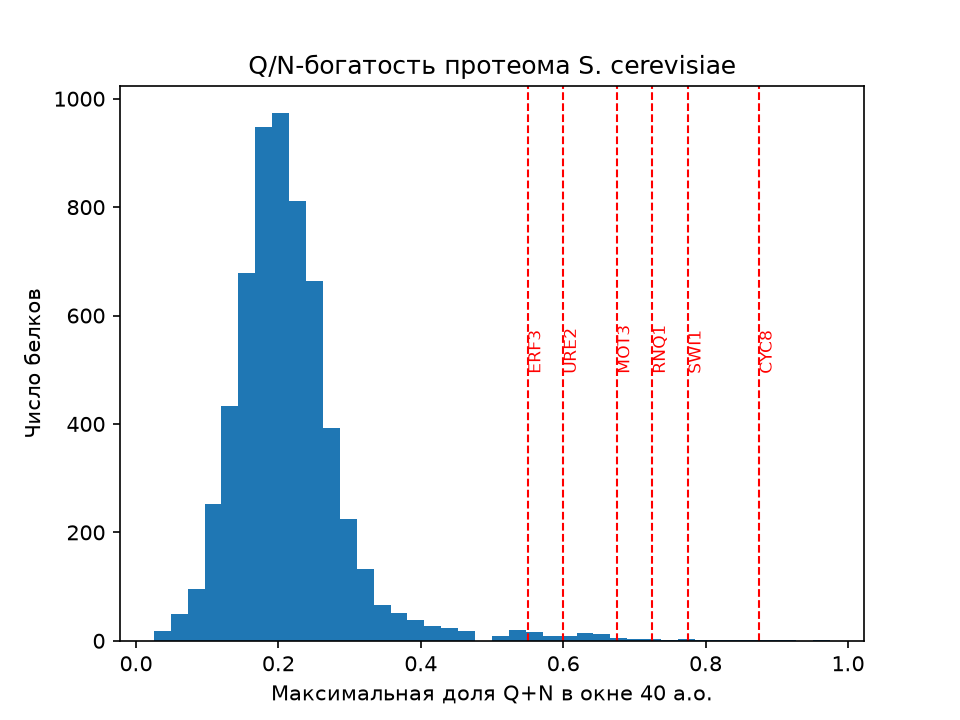
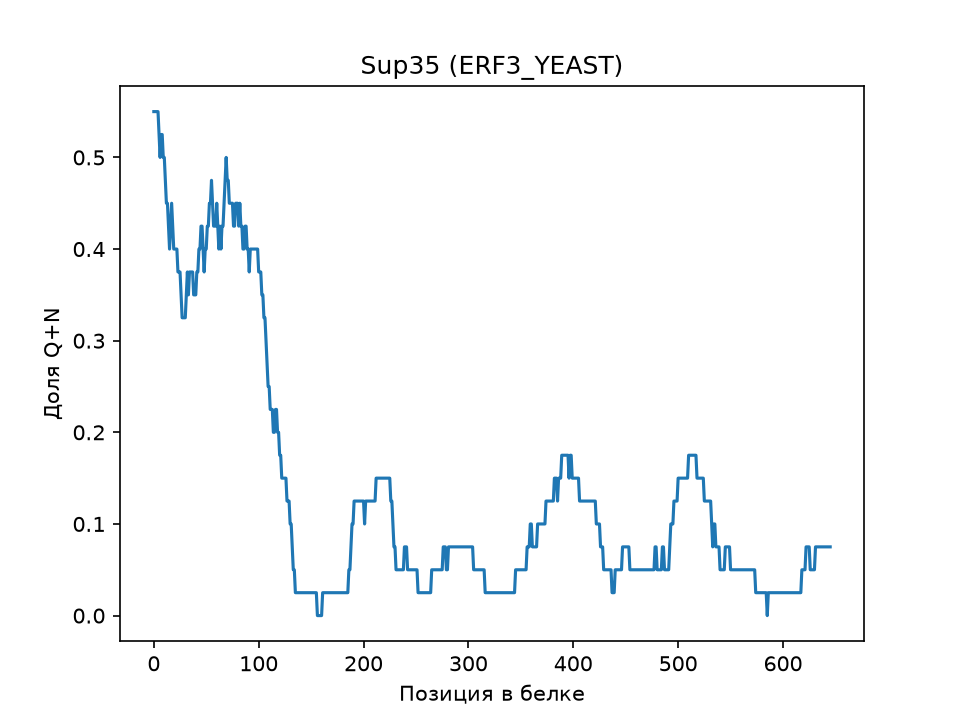

# Поиск Q/N-богатых участков в протеоме S. cerevisiae

Цель: проверить, выделяются ли известные дрожжевые прионы по
содержанию аспарагина и глутамина.

Метод: скользящее окно 40 а.о., доля Q+N, максимум по белку.
Данные: протеом UniProt UP000002311.

Результат: известные прионы (Swi1, Rnq1, Mot3, Cyc8, Ure2, Sup35)
находятся в правом хвосте распределения (см. hist.png).

Ограничения: не учитываются Y и G, неупорядоченность участка,
порядок аминокислот. Q/N-богатость не доказывает прионную природу.
Многие белки в топе — транскрипционные факторы, где такие участки
выполняют другую функцию.
## Результаты

| Белок | Доля Q+N | Место из 6016 |
|---|---|---|
| Cyc8 | 0,88 | 4 |
| Swi1 | 0,78 | 10 |
| Rnq1 | 0,72 | 17 |
| Mot3 | 0,68 | 25 |
| Ure2 | 0,60 | 57 |
| Sup35 (ERF3) | 0,55 | 71 |

Все шесть известных прионов входят в верхние ~1,2% протеома.

## Как запустить

pip install matplotlib
python qn_scan.py
